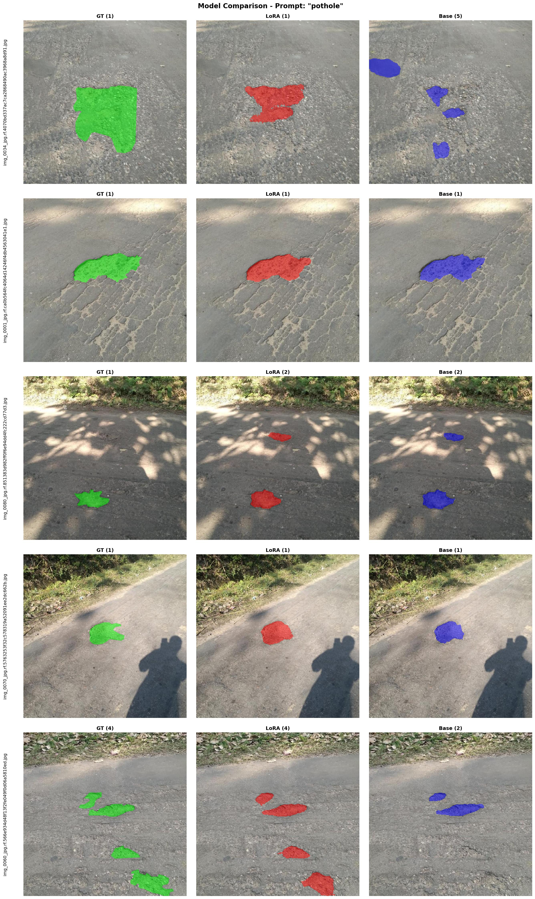

# SAM3-LoRA: Efficient Fine-Tuning with Low-Rank Adaptation

<div align="center">

[](https://github.com/Sompote/SAM3_LoRA)
[](https://www.python.org/downloads/)
[](https://pytorch.org/)
[](LICENSE)

**Train SAM3 segmentation models with 99% fewer trainable parameters**

[Quick Start](#quick-start) • [Architecture](#architecture) • [Training](#training) • [Validation](#validation) • [Inference](#inference) • [Examples](#real-world-example-concrete-crack-detection) • [Configuration](#configuration) • [Troubleshooting](#troubleshooting)

</div>

---

## Overview

Fine-tune SAM3 (Segment Anything Model 3) on your own dataset using **LoRA (Low-Rank Adaptation)** — a parameter-efficient method that reduces trainable parameters from 100% to ~1% while maintaining performance. Train on a standard COCO-format dataset with text prompts taken from your category names, while preserving SAM3's open-vocabulary behavior: the fine-tuned model segments your target classes (e.g. `crack`, `hole`) and still returns **nothing** for unrelated prompts (e.g. `car`).

### Recent Updates

**2026-08-23 (v0.4.0)**:
- **Train on descriptions, not just class names** — the text prompt no longer has to be the COCO category name. Two data formats, selected with `training.data_format`:
  - `coco` (default) — the same `_annotations.coco.json` you already have, now resolving prompts from `annotation["caption"]` (per **segment**) → `image["caption"]` (per **image**) → `category["description"]` (per **class**, RF100-VL style) → `category["name"]`. An unmodified export behaves exactly as before. Descriptions may also live in a `_descriptions.json` sidecar so Roboflow re-exports never overwrite them. `prompt_source` forces one level; `mix_class_prompt` trains the bare class name as a second prompt alongside the description
  - `odvg` — Grounding-DINO ODVG jsonl, a phrase per region plus a whole-image `grounding.caption`. Masks (`segmentation`/`mask`, polygon or RLE) and detection-mode lines are supported; identical phrases within an image are grouped into one multi-target query
- **New: `convert_coco_to_odvg.py`** — Roboflow has no ODVG export, so this converts a COCO split to `_annotations.odvg.jsonl`, preserving masks and emitting `tokens_positive` wherever a phrase occurs verbatim in the caption
- **Negative sampling adapts to the prompt corpus** — with class names every absent prompt is still always a negative; past 50 distinct prompts (what per-segment descriptions produce) `num_cross_negatives` are sampled per image instead, so one image no longer generates thousands of queries
- **Fixed object/text misalignment in the COCO loader** — an annotation skipped for an unreadable mask still appended its class name, shifting every later object's text onto the wrong instance. Text is now appended with the object it belongs to. See [Training on descriptions](#training-on-descriptions-not-just-class-names)

**2026-08-01 (v0.3.0)**:
- **Guaranteed cross-class hard negatives** — negatives are now two-tier: every dataset category absent from an image is **always** added as a must-return-nothing prompt (previously it was only randomly sampled, far too rare to separate confusable classes like `crack` vs `water ingress` — all prompts ended up segmenting the same defect). `num_negatives` now controls only the extra generic out-of-domain prompts sampled per image. Generic negatives that share a word with a dataset category (e.g. `water` vs `water ingress`) are removed automatically — training them to return nothing contradicts the related positive class. See [Preserving prompt discrimination](#preserving-prompt-discrimination-important)
- **Fixed baseline validation scoring ~0 mAP** — `validate_sam3_lora.py` scored detections with raw `pred_logits` only, but SAM3's image model keeps the **presence score** separate (the official `PostProcessImage` multiplies it in). Without it, the zero-shot baseline floods every prompt with confident false detections and its mAP collapses to 0. Validation now uses the joint score `sigmoid(logit) × sigmoid(presence)` by default (`--no-presence` restores the old behavior). LoRA numbers also change slightly — rerun both sides for a fair comparison
- **New: pixel-level metrics** (`--pixel-metrics`, default on) — reports semantic IoU / precision / recall on the union of masks per prompt, alongside mAP/cgF1. Instance matching triple-penalizes a single GT crack predicted as several fragments (missed GT + each fragment a false positive); pixel metrics measure coverage regardless of fragmentation. See [Fragmented predictions](#fragmented-predictions-and-pixel-level-metrics-cracks)
- **New: proximity merging** (`--merge-dilate N`) — `--merge` only fused *overlapping* fragments (disjoint crack portions have mask IoU 0 and never merged). With a dilation radius, fragments whose dilated masks touch are joined into one instance before matching
- **New: box/score display options in evaluation scripts** — `compare_lora_base.py` / `compare_lora_base_batch.py` gain `--boundingbox True/False` and `--score True/False` (per-detection confidence labels, no boxes required); `infer_sam.py` gains `--score` so confidence shows independently of `--boundingbox`

**2026-07-05 (v0.2.0)**:
- **Fixed loss of prompt discrimination after fine-tuning** — previously the model detected trained objects regardless of the text prompt (e.g. segmenting cracks when prompted `car`). Root cause: positive-only training queries. See [Preserving prompt discrimination](#preserving-prompt-discrimination-important)
- **Automatic hard-negative text prompts** — new `num_negatives` config option; the trainers now add per-image prompts that must return zero detections, drawn from your other dataset categories plus a built-in generic pool. New `generic_negatives` config option overrides the pool when a default concept (e.g. `road`) can genuinely appear in your images. Validation loss includes the negative prompts, so it tracks discrimination during training
- **Text encoder frozen by default** (`apply_to_text_encoder: false`) to preserve SAM3's text↔image alignment
- **Fixed `apply_to_mask_decoder` having no effect** (#28) — SAM3's mask module is named `segmentation_head`, which the component filter didn't match, so the flag was silently ignored (and the head's cross-attention was always adapted regardless of the setting). The flag now correctly controls LoRA on the segmentation head
- **New: merge LoRA into the base model** (#30) — `merge_lora_weights.py` folds a trained adapter into the base weights, producing a single checkpoint that loads into stock SAM3 with no LoRA code. See [Merging LoRA weights](#merging-lora-weights-into-the-base-model)
- **New: RefCOCO / RRSIS-D support** (#26) — `convert_refcoco_to_coco.py` converts referring-expression datasets to the trainers' COCO layout, with expression-level (`--mode ref`) or class-level (`--mode category`) prompts. See [Prepare Your Data](#1-prepare-your-data)

**2026-02-03**:
- **Fixed multi-class category assignment bug** in training/validation
- Previously, images with multiple categories incorrectly assigned all objects to the mode (most frequent) category
- Now creates separate queries per category, mapping each object to its actual class
- Affected files: `train_sam3_lora_native.py`, `train_sam3_lora_with_categories.py`, `validate_sam3_lora.py`

**2026-01-31**:
- **Replaced `--no-boxes` with `--boundingbox` option** in `infer_sam.py`
- New `--boundingbox True/False` flag for explicit bounding box control (default: False)
- Updated README documentation and inference examples

**2026-01-04**:
- **Added Multi-GPU training support** using DistributedDataParallel (DDP)
- New `--device` argument for easy GPU selection: `--device 0 1 2 3`
- Automatic torchrun launch when multiple GPUs specified
- Linear scaling of effective batch size across GPUs


### Why Use This?

- ✅ **Train on Consumer GPUs**: 16GB VRAM instead of 80GB
- ✅ **Tiny Checkpoints**: 10-50MB LoRA weights vs 3GB full model
- ✅ **Fast Iterations**: Less memory = faster training
- ✅ **Easy to Use**: standard COCO dataset + YAML configs + simple CLI
- ✅ **Keeps Prompt Discrimination**: automatic hard-negative prompts, so the tuned model doesn't fire on unrelated words
- ✅ **Production Ready**: Complete train + inference pipeline
- ✅ **Real Applications**: Crack detection, defect inspection, and more
- ✅ **Multi-GPU Support**: Scale training across multiple GPUs with `--device 0 1 2 3`

### What is LoRA?

Instead of fine-tuning all model weights, LoRA injects small trainable matrices:
```
W' = W_frozen + B×A  (where rank << model_dim)
```

**Result**: Only ~1% of parameters need training!

### Architecture

SAM3-LoRA applies Low-Rank Adaptation to key components of the SAM3 architecture:

<div align="center">

<br>
<em>SAM3 Model Architecture with Full LoRA Adaptation</em>
</div>

<br>

**LoRA Adapters Applied To:**

| Component | Description | Default | Notes |
|-----------|-------------|---------|-------|
| **Vision Encoder (ViT)** | Extracts visual features from input images | LoRA ✅ | High impact - primary feature learning |
| **Text Encoder** | Processes text prompts for guided segmentation | **Frozen** ❄️ | Keep frozen — adapting it erodes prompt discrimination |
| **Geometry Encoder** | Handles geometric prompts (boxes, points) | Frozen | Enable if using box/point prompts |
| **DETR Encoder** | Transformer encoder for object detection | LoRA ✅ | High impact - vision-text fusion |
| **DETR Decoder** | Transformer decoder for object queries | LoRA ✅ | High impact - object localization |
| **Mask Decoder** | Generates segmentation masks | Frozen | Enable for fine-grained mask quality (on in `light_lora_config`) |

**Data Flow:**
1. **Input**: Image + Text/Geometric prompts
2. **Encoding**: Multiple encoders process different modalities
3. **Transformation**: DETR encoder-decoder refines representations
4. **Output**: High-quality segmentation masks

**LoRA Benefits:**
- ✅ Only ~1% parameters trainable (frozen base + small adapters)
- ✅ Adapters can be swapped for different tasks
- ✅ Original model weights preserved
- ✅ Efficient storage (10-50MB vs 3GB full model)

---

## Installation

### Prerequisites

Before installing, you need to:

1. **Request SAM3 Access on Hugging Face**
   - Go to [facebook/sam3 on Hugging Face](https://huggingface.co/facebook/sam3)
   - Click "Request Access" and accept the license terms
   - Wait for approval (usually instant to a few hours)

2. **Get Your Hugging Face Token**
   - Go to [Hugging Face Settings > Tokens](https://huggingface.co/settings/tokens)
   - Create a new token or use existing one
   - Copy the token (you'll need it in the next step)

### Install

```bash
# Clone repository
git clone https://github.com/Sompote/SAM3_LoRA.git
cd SAM3_LoRA

# Install dependencies
pip install -e .

# Login to Hugging Face
hf auth login
# Paste your token when prompted
```

**Alternative login method:**
```bash
# Or set token as environment variable
export HF_TOKEN="your_token_here"
```

**Requirements**: Python 3.8+, PyTorch 2.0+, CUDA (optional), Hugging Face account with SAM3 access

### Verification

Verify your setup is complete:

```bash
# Test Hugging Face login
huggingface-cli whoami

# Test SAM3 access (should not give access error)
python3 -c "from transformers import AutoModel; print('✓ SAM3 accessible')"
```

If you see errors, review the [Troubleshooting](#troubleshooting) section.

---

## Quick Start

> **⚠️ Important**: Make sure you've completed the [Installation](#installation) steps, including Hugging Face login, before proceeding.

**Example Result**: Train a model to detect concrete cracks with just ~1% trainable parameters!

<div align="center">

<br>
<em>Detection: "concrete crack" with 0.32 confidence • Precise segmentation mask</em>
</div>

<br>

### 1. Prepare Your Data

Organize your dataset in **COCO format** with a single annotation file per split:

```
data/
├── train/                    # Required
│   ├── img001.jpg
│   ├── img002.jpg
│   └── _annotations.coco.json
├── valid/                    # Optional but recommended
│   ├── img001.jpg
│   ├── img002.jpg
│   └── _annotations.coco.json
└── test/                     # Optional
    ├── img001.jpg
    └── _annotations.coco.json
```

> **Note**: Validation data (`data/valid/`) is **optional** but strongly recommended for monitoring training progress and preventing overfitting.

**COCO Annotation Format** (`_annotations.coco.json`):
```json
{
  "images": [
    {
      "id": 0,
      "file_name": "img001.jpg",
      "height": 480,
      "width": 640
    }
  ],
  "annotations": [
    {
      "id": 1,
      "image_id": 0,
      "category_id": 1,
      "bbox": [x, y, width, height],
      "area": 1234,
      "segmentation": [[x1, y1, x2, y2, ...]],
      "iscrowd": 0
    }
  ],
  "categories": [
    {"id": 1, "name": "defect"}
  ]
}
```

**Supported Segmentation Formats:**
- **Polygon**: `"segmentation": [[x1, y1, x2, y2, ...]]` (list of polygons)
- **RLE**: `"segmentation": {"counts": "...", "size": [h, w]}` (run-length encoded)

**Using RefCOCO-format datasets (RefCOCO, RRSIS-D, ...):** referring-expression
datasets ship as `instances.json` + a `refs(*).p` pickle instead of per-split
COCO files. Convert them with:

```bash
python3 convert_refcoco_to_coco.py \
    --refcoco-dir RRSIS-D/rrsisd \
    --images-dir RRSIS-D/images/rrsisd/JPEGImages \
    --output-dir data/rrsisd_coco \
    --mode ref
```

`--mode ref` (default) turns each referring expression into a text prompt for
exactly the one instance it refers to — true referring segmentation; keep
`num_negatives` enabled so other expressions serve as hard negatives.
`--mode category` ignores the expressions and produces plain class-level
detection data from the original COCO categories. Use `--symlink` to link
images instead of copying.

---

#### Training on descriptions, not just class names

By default the text prompt SAM3 trains on is the **category name** (`crack`).
Two data formats let you train on a real **description** instead. Pick one with
`training.data_format`:

| `data_format` | File | Text lives in | Best when |
|---------------|------|---------------|-----------|
| `coco` *(default)* | `_annotations.coco.json` | `caption` / `description` fields, or a `_descriptions.json` sidecar | You already have a Roboflow/COCO export and want to add text to it |
| `odvg` | `_annotations.odvg.jsonl` | a `phrase` per region + a whole-image `caption` | Descriptions are phrases cut from one sentence about the image |

An **unmodified export keeps working exactly as before** — no text found means
the class name is used, same as every previous version.

<details>
<summary><b>Format 1 — <code>coco</code>: descriptions inside your COCO file</b> &nbsp;<i>(default, click to expand)</i></summary>

<br>

Same folder layout as above. The prompt for each annotation is resolved in this
order, **first hit wins**:

| # | Where the text is read from | Grain |
|---|------------------------------|-------|
| 1 | `annotation["caption"]` &rarr; `["description"]` &rarr; `["text"]` &rarr; `["phrase"]` &rarr; `["expression"]` | per **segment** |
| 2 | `image["caption"]` &rarr; `["description"]` &rarr; `["text"]` | per **image** |
| 3 | `category["description"]` &rarr; `["caption"]` &rarr; `["instructions"]` &rarr; `["prompt"]` | per **class** (RF100-VL style) |
| 4 | `category["name"]` | class name *(fallback)* |

##### How to format your data

**Option A — per class** *(easiest; one sentence per class, whole dataset)*

Add `description` to each entry in `categories`. Nothing else changes:

```json
{
  "categories": [
    {"id": 1, "name": "crack",
     "description": "a long thin fracture in the concrete surface"},
    {"id": 2, "name": "spall",
     "description": "a shallow patch where concrete has flaked away"}
  ]
}
```

**Option B — per image** *(one sentence per picture, applies to all its objects)*

Add `caption` to each entry in `images`:

```json
{
  "images": [
    {"id": 0, "file_name": "pier_07.jpg", "height": 480, "width": 640,
     "caption": "cracks on a weathered concrete bridge pier"}
  ]
}
```

**Option C — per segment** *(most precise; a referring expression per mask)*

Add `caption` to each entry in `annotations`. Each mask gets its own sentence,
and each sentence trains to return only that one instance:

```json
{
  "annotations": [
    {"id": 1, "image_id": 0, "category_id": 1,
     "bbox": [120, 84, 210, 46],
     "segmentation": [[x1, y1, x2, y2, "..."]],
     "caption": "long diagonal crack near the ledge"},
    {"id": 2, "image_id": 0, "category_id": 1,
     "bbox": [40, 300, 60, 22],
     "segmentation": [[x1, y1, x2, y2, "..."]],
     "caption": "hairline crack at the slab edge"}
  ]
}
```

You can mix all three in one file — level 1 wins where it exists, level 2 fills
the gaps, level 3 catches the rest.

**Option D — the `_descriptions.json` sidecar** *(recommended if you re-export)*

Roboflow overwrites `_annotations.coco.json` every time you export. Put the text
in a sidecar next to it instead and it survives:

```
data/train/
├── img001.jpg
├── _annotations.coco.json     # Roboflow writes this — never edited
└── _descriptions.json         # yours
```

```json
{
  "by_annotation": {"1": "long diagonal crack near the ledge"},
  "by_image":      {"pier_07.jpg": "cracks on a concrete bridge pier"},
  "by_category":   {"crack": "a long thin fracture in the concrete surface"}
}
```

All three blocks are optional. `by_annotation` is keyed by COCO annotation
`id`; `by_image` accepts either the file name or the image `id`; `by_category`
is keyed by lowercase class name. **Sidecar entries beat inline JSON fields at
the same level.**

##### Config

```yaml
training:
  data_format: "coco"
  prompt_source: "auto"        # auto | caption | image_caption
                               # | category_description | category_name
  mix_class_prompt: false      # also train the bare class name as a 2nd prompt
```

`prompt_source: "auto"` walks the table above. Force a single level with
`caption`, `image_caption` or `category_description` — those still fall back to
the class name where that level is missing, so a partially-described dataset
never trains on an empty prompt. `category_name` restores the old behavior
outright.

`mix_class_prompt: true` emits **both** queries per object — the description
*and* the bare class name — so the tuned model answers to `crack` as well as
`long diagonal crack near the ledge`. It roughly doubles the queries per image,
and therefore the step time.

##### What the trainer actually builds

For an image with two `crack` annotations, the first captioned and the second
not, with a per-image caption present, `prompt_source: auto` produces:

```
  1 target   <- 'long diagonal crack near the ledge'      # ann 1, its own caption
  1 target   <- 'cracks on a weathered concrete pier'     # ann 2, image fallback
  0 targets  <- 'spall'                                   # absent class -> negative
  0 targets  <- 'car'                                     # generic negative
```

Objects sharing a prompt are grouped into **one query with several targets**,
not competing single-target queries.

</details>

<details>
<summary><b>Format 2 — <code>odvg</code>: Grounding-DINO ODVG jsonl</b> &nbsp;<i>(click to expand)</i></summary>

<br>

`<data_dir>/<split>/_annotations.odvg.jsonl` — one JSON object per line, images
in the same directory. Each region carries **its own phrase**, and
`grounding.caption` is the sentence those phrases were cut from;
`tokens_positive` records where in that sentence each phrase sits.

```json
{"filename": "pier_07.jpg", "height": 693, "width": 1024,
 "grounding": {
   "caption": "a long diagonal crack under the ledge and rust below it",
   "regions": [
     {"phrase": "a long diagonal crack under the ledge",
      "bbox": [20, 215, 985, 665],
      "tokens_positive": [[0, 37]],
      "segmentation": [[20, 215, 985, 215, 985, 665, 20, 665]]},
     {"phrase": "rust",
      "bbox": [412, 588, 690, 672],
      "tokens_positive": [[46, 50]],
      "segmentation": {"counts": "...", "size": [693, 1024]}}
   ]}}
```

##### Field reference

| Field | Required | Notes |
|-------|----------|-------|
| `filename` | yes | Relative to the split directory |
| `height`, `width` | no | Falls back to the image on disk |
| `grounding.caption` | no | Whole-image sentence; trained as an extra query when `use_full_caption` is on |
| `grounding.regions[].phrase` | yes | The per-segment text. `caption` / `category` / `text` also accepted |
| `grounding.regions[].bbox` | yes | **Absolute `[x1, y1, x2, y2]`** — note COCO uses `[x, y, w, h]` |
| `grounding.regions[].segmentation` | no | Polygon list or RLE dict. `mask` accepted as an alias. Without it the sample trains boxes only |
| `grounding.regions[].tokens_positive` | no | Char spans into `caption`. Read for provenance; not required by the trainer |
| `detection.instances[]` | — | Detection-mode alternative to `grounding.regions`; `category` is used as the phrase |

##### How to format your data

**Option A — convert an existing COCO export** *(recommended)*

Roboflow has no ODVG export, so this bridges the gap. Masks are preserved and
`tokens_positive` is emitted wherever a phrase occurs verbatim in the caption:

```bash
# every split under a dataset root
python3 convert_coco_to_odvg.py --data-dir data/crack

# a single split
python3 convert_coco_to_odvg.py --split-dir data/crack/train

# boxes only, drop masks
python3 convert_coco_to_odvg.py --data-dir data/crack --no-masks

# omit images with no annotations instead of keeping them as caption-only rows
python3 convert_coco_to_odvg.py --data-dir data/crack --skip-empty
```

The converter reads text with the same resolution order as Format 1
(`annotation` &rarr; `category` description &rarr; class name), honours
`_descriptions.json`, and synthesizes `grounding.caption` by joining the
distinct phrases when an image has no caption of its own.

**Option B — write it yourself**

One `json.dumps(...)` per line, no wrapping array, no trailing comma:

```python
import json

with open("data/crack/train/_annotations.odvg.jsonl", "w") as f:
    for sample in my_samples:
        f.write(json.dumps({
            "filename": sample.file_name,
            "height": sample.height,
            "width": sample.width,
            "grounding": {
                "caption": sample.sentence,
                "regions": [
                    {"phrase": r.phrase,
                     "bbox": [r.x1, r.y1, r.x2, r.y2],       # absolute xyxy
                     "segmentation": r.polygon}              # [[x1,y1,x2,y2,...]]
                    for r in sample.regions
                ],
            },
        }) + "\n")
```

**Option C — detection mode** *(class-level, no sentence)*

```json
{"filename": "pier_07.jpg", "height": 693, "width": 1024,
 "detection": {"instances": [
   {"bbox": [20, 215, 985, 665], "label": 0, "category": "crack",
    "mask": {"counts": "...", "size": [693, 1024]}}]}}
```

##### Config

```yaml
training:
  data_format: "odvg"
  use_full_caption: true                            # extra whole-image query
  # odvg_annotations_file: "_annotations.odvg.jsonl"
```

##### What the trainer actually builds

For the `pier_07.jpg` line above, plus a third region also phrased `rust`:

```
  1 target   <- 'a long diagonal crack under the ledge'
  2 targets  <- 'rust'                                     # both regions, one query
  3 targets  <- 'a long diagonal crack under the ledge and rust below it'
  0 targets  <- 'spall'                                    # phrase from another image
```

Regions sharing a phrase within one image are **grouped into a single
multi-target query** rather than competing single-target ones. With
`use_full_caption: true` (default) the whole-image sentence becomes an extra
query targeting every region it grounds — so you train the sentence and its
constituent phrases from one annotation.

</details>

<details>
<summary><b>Which granularity should I use?</b></summary>

<br>

| | Per class | Per image | Per segment |
|---|-----------|-----------|-------------|
| Effort | one line per class | one line per image | one line per mask |
| Distinct prompts | = number of classes | ≈ number of images | ≈ number of masks |
| Model learns | a richer definition of each class | what this scene contains | which *specific* instance a sentence means |
| Negatives | every absent class, always | sampled *(see below)* | sampled *(see below)* |
| Closest to | RF100-VL labeling instructions | image captioning | RefCOCO / referring segmentation |
| Use when | class names are ambiguous (`defect`, `type 2`) | scenes differ more than objects do | several instances of one class must be told apart |

If you only want *"this mask means this sentence"*, **per segment** is the one.
If your class names are just terse (`crack` for what is really a fracture in
concrete), **per class** gets most of the benefit for a fraction of the work.

</details>

<details>
<summary><b>How hard negatives work with free text</b></summary>

<br>

The [two-tier negative scheme](#preserving-prompt-discrimination-important) still
applies, but the in-domain tier adapts to how many distinct prompts exist:

| Prompt corpus | In-domain negatives per image |
|---------------|-------------------------------|
| ≤ 50 distinct texts *(class names, per-class descriptions)* | **every** absent prompt, always — unchanged behavior |
| > 50 distinct texts *(per-image, per-segment descriptions)* | `num_cross_negatives` sampled per image (default 2) |

Without that switch a per-segment dataset would emit one negative query per
*other caption in the split* — thousands per image. The generic out-of-domain
tier (`num_negatives`) is unaffected, and pool entries sharing a word with any
positive prompt are still removed automatically.

```yaml
training:
  num_negatives: 3          # generic out-of-domain prompts per image
  num_cross_negatives: 2    # in-domain prompts sampled once the corpus is large
```

Raise `num_cross_negatives` if the tuned model starts firing on the wrong
description; lower it if step time is the constraint.

</details>

<details>
<summary><b>Writing descriptions that actually help</b></summary>

<br>

SAM3 was pretrained on **short noun phrases**, not sentences. Its text encoder
is frozen by default here, so descriptions that drift far from that distribution
train poorly.

**Do**

- Keep it to a noun phrase: `long diagonal crack near the ledge`
- Lead with the object, qualify after: `crack running under the window ledge`
- Use words that distinguish instances if that is what you need to teach:
  `crack on the left pier` vs `crack on the right pier`
- Stay consistent — the same defect should get the same phrasing across images

**Avoid**

- Full sentences with verbs and articles: `There is a crack that runs...`
- Instructions or meta text: `annotate any crack wider than 2mm`
- Very long strings — they get truncated by the text encoder
- Phrases that contradict a negative: if `water` is in the generic negative
  pool and your class is `water ingress`, the pool entry is dropped
  automatically, but hand-written `generic_negatives` are not checked as
  thoroughly

</details>

<details>
<summary><b>Config key reference</b></summary>

<br>

All under `training:` in your YAML config.

| Key | Default | Applies to | Meaning |
|-----|---------|------------|---------|
| `data_format` | `"coco"` | both | `coco` or `odvg` |
| `prompt_source` | `"auto"` | coco | `auto` \| `caption` \| `image_caption` \| `category_description` \| `category_name` |
| `mix_class_prompt` | `false` | coco | Also emit the bare class-name query alongside the description |
| `use_full_caption` | `true` | odvg | Emit an extra whole-image query for `grounding.caption` |
| `odvg_annotations_file` | `"_annotations.odvg.jsonl"` | odvg | Override the jsonl filename |
| `num_cross_negatives` | `2` | both | In-domain negatives sampled per image once the corpus exceeds 50 distinct prompts |
| `num_negatives` | `2` | both | Generic out-of-domain negatives sampled per image |
| `generic_negatives` | built-in pool | both | Replace the out-of-domain pool |

</details>

<details>
<summary><b>Check your data before starting a long run</b></summary>

<br>

Load one sample and print the queries the trainer will actually see:

```python
# COCO format
from train_sam3_lora_native import COCOSegmentDataset
ds = COCOSegmentDataset(data_dir="data", split="train")

# ODVG format
# from dataset_formats import ODVGDataset
# ds = ODVGDataset(data_dir="data", split="train")

dp = ds[0]
for q in dp.find_queries:
    print(f"{len(q.object_ids_output):3d} targets  <- {q.query_text!r}")
```

The loader also prints a summary when it starts:

```
Loaded COCO dataset: train split
  Images: 412
  Annotations: 1038
  Categories: {1: 'crack', 2: 'spall'}
  Prompt source: auto (descriptions found)
  Distinct prompts: 1038
  Prompt corpus > 50: sampling 2 cross-prompt negatives per image
```

`Prompt source: ... (class names)` means **no descriptions were found** and it
is training on category names — check your field names against the resolution
order above.

</details>

> **Note**: `validate_sam3_lora.py` still prompts with **category names**. If
> you train on per-segment or per-image descriptions, its mAP/cgF1 numbers
> measure the class-name prompt, not the descriptions. Training-time validation
> loss (computed by the trainer) does use the same prompts as training.

### 2. Train Your Model

```bash
# Train with default config
python3 train_sam3_lora_native.py

# Or specify custom config
python3 train_sam3_lora_native.py --config configs/full_lora_config.yaml
```

**Expected output:**
```
Building SAM3 model...
Applying LoRA...
Applied LoRA to 64 modules
Trainable params: 11,796,480 (1.38%)

Loading training data from /workspace/data2...
Loaded COCO dataset: train split
  Images: 778
  Annotations: 1631
  Categories: {0: 'CRACKS', 1: 'CRACKS', 2: 'JOINT', 3: 'LOCATION', 4: 'MARKING'}

Loading validation data from /workspace/data2...
Loaded COCO dataset: valid split
  Images: 152
  Annotations: 298
Found validation data: 152 images
Starting training for 100 epochs...
Training samples: 778, Validation samples: 152

Epoch 1: 100%|████████| 98/98 [07:47<00:00, loss=140]
Validation: 100%|████████| 19/19 [00:32<00:00, val_loss=23.7]

Epoch 1/100 - Train Loss: 156.234567, Val Loss: 17.032280
✓ New best model saved (val_loss: 17.032280)

Epoch 2: 100%|████████| 98/98 [07:24<00:00, loss=167]
Validation: 100%|████████| 19/19 [00:31<00:00, val_loss=20.1]

Epoch 2/100 - Train Loss: 142.891234, Val Loss: 15.641912
✓ New best model saved (val_loss: 15.641912)
...
```

**Validation Strategy** (mirrors how SAM3's own training/eval code is organized — see note below):
- **During training**: Only validation **loss** is computed (fast, no NMS or metrics)
- **After training**: Run `validate_sam3_lora.py` for full metrics (mAP, cgF1) with NMS

This approach significantly speeds up training while still monitoring overfitting via validation loss.

> **Note on "mirrors SAM3":** this is *not* a documented policy quoted from the SAM3
> repo — it's a design choice in this repo that follows how SAM3's code is
> structured. Two concrete sources motivate it: (1) SAM3's trainer runs a periodic
> validation pass that accumulates **loss/meters** on a configurable cadence
> (`sam3/train/trainer.py`, e.g. `val_epoch_freq` / `Phase.VAL`); and (2) full
> COCO mAP / cgF1 live in **separate offline evaluators**
> (`sam3/eval/coco_eval_offline.py`, `sam3/eval/cgf1_eval.py`) that are run as a
> distinct step — the COCO evaluator's own docstring notes category mAP requires
> predicting over every `(image, class)` pair, which is why it's kept out of the
> training loop. If you have an official SAM3 statement on eval cadence, a pointer
> is welcome so we can cite it directly.

### 3. Run Inference

```bash
# Basic inference (automatically uses best model)
python3 infer_sam.py \
  --config configs/full_lora_config.yaml \
  --image test_image.jpg \
  --output predictions.png

# With text prompt for better accuracy
python3 infer_sam.py \
  --config configs/full_lora_config.yaml \
  --image test_image.jpg \
  --prompt "yellow school bus" \
  --output predictions.png

# Multiple prompts to detect different objects
python3 infer_sam.py \
  --config configs/full_lora_config.yaml \
  --image test_image.jpg \
  --prompt "crack" "defect" "damage" \
  --output predictions.png
```

---

## Training

### Basic Training

```bash
# Use default configuration (single GPU)
python3 train_sam3_lora_native.py

# Or specify custom config
python3 train_sam3_lora_native.py --config configs/full_lora_config.yaml
```

### Preserving prompt discrimination (important)

A common issue after fine-tuning is that the model **detects the trained objects
regardless of the text prompt** — e.g. after training on `crack`/`hole` it still
segments cracks when you prompt `"car"`. This happens because SAM3 is an
open-vocabulary detector, but the dataset only ever provides **positive**
prompts (every prompt has matching boxes). The presence head then decouples from
the text condition and learns to "always fire."

Two settings fix this:

1. **Hard-negative text queries** — prompts that must return **nothing** for an
   image. The dataloader adds them in two tiers:

   - **In-domain negatives (always added).** Every dataset category absent from
     an image becomes a zero-detection query on that image. These are the
     confusable prompts — on a water-ingress image, `crack` and
     `concrete spalling` are told to return nothing, every single epoch. When
     these were only randomly sampled, the signal was too rare for the model to
     keep visually similar classes apart: after fine-tuning, all three prompts
     segmented the same defect.
   - **Generic out-of-domain negatives (sampled).** `num_negatives` prompts per
     image drawn from a built-in pool (`car`, `person`, `dog`, …). `2`–`4`
     works well; `0` disables this tier only. The shipped configs set `3`.

   ```yaml
   training:
     num_negatives: 3   # generic tier only; absent dataset categories are always added
   ```

   If a concept from the default generic pool can genuinely appear in your
   images (e.g. `road` in pavement-crack photos — teaching "no road here" on a
   picture of a road is wrong supervision), replace the pool with objects that
   never appear in your data:

   ```yaml
   training:
     generic_negatives: ["car", "person", "dog", "bicycle", "bottle"]
   ```

   Pool entries that share a word with one of your dataset categories are
   removed automatically (e.g. `water` is dropped when a category is named
   `water ingress`) — training `water` to return nothing on images full of
   water ingress would contradict the positive class.

2. **Keep the text encoder frozen** (`apply_to_text_encoder: false`). Adapting
   the text encoder distorts SAM3's text↔image alignment — the very thing that
   separates `crack` from `car`. Leave it frozen unless you have a strong reason
   not to.

   ```yaml
   lora:
     apply_to_text_encoder: false
   ```

Also avoid over-training on small datasets (hundreds of epochs amplifies the
collapse); prefer a lower learning rate and fewer epochs, and watch the
validation loss, which now includes the negative prompts.

#### Do negatives generalize to prompts outside the pool?

Yes — the negative pool is **not a blocklist**. If you train with
`generic_negatives: ["car", "person", "dog", "bicycle", "bottle"]` and later
prompt `plane`, the model should still return nothing, even though `plane` was
never a training negative.

The negatives don't teach the model "don't fire on the word car" — they retrain
the presence head's general decision rule: *fire only when the text embedding
actually matches the visual features*. Each negative is one demonstration of
that rule; the model relearns the rule, not the word list. The frozen text
encoder is what makes this work: SAM3's pretrained encoder already places
`plane` near `car`/`bicycle` and far from `crack`, and freezing it
(`apply_to_text_encoder: false`) keeps that concept space intact — the
negatives just re-anchor the presence head to use it again. A more diverse pool
generalizes further, which is why the built-in one spans 20 varied concepts.

**The caveat is near-synonyms of your target classes.** After training on
`crack`/`hole`/`deep crack`, prompts like `scratch`, `fracture`, `gap`, or
`line` sit close to `crack` in the text encoder's space and may still trigger
detections. That's the model honestly saying "this concept looks like what I
was trained to find" — whether that's desired depends on your use case. If a
specific nearby word must return nothing, add exactly that word to
`generic_negatives`.

After retraining, spot-check three rings of prompts:

1. **Trained classes** (`crack`, `hole`) — should segment correctly.
2. **Clearly unrelated words, including ones NOT in your pool** (`plane`,
   `banana`, `keyboard`) — should return nothing. This verifies generalization
   rather than memorization.
3. **Near-synonyms** (`scratch`, `gap`) — check the behavior matches what you
   want; add problem words to the pool if not.

If ring 2 still fires, increase `num_negatives`, diversify the pool, or reduce
over-training (fewer epochs / lower LR) — don't try to enumerate every English
word.

### Multi-GPU Training

Train on multiple GPUs using the `--device` argument. The script automatically handles distributed training setup.

```bash
# Single GPU (default - GPU 0)
python3 train_sam3_lora_native.py --config configs/full_lora_config.yaml

# Single GPU (specific GPU)
python3 train_sam3_lora_native.py --config configs/full_lora_config.yaml --device 1

# Multi-GPU (2 GPUs)
python3 train_sam3_lora_native.py --config configs/full_lora_config.yaml --device 0 1

# Multi-GPU (4 GPUs)
python3 train_sam3_lora_native.py --config configs/full_lora_config.yaml --device 0 1 2 3

# Multi-GPU (specific GPUs, e.g., 0, 2, 3)
python3 train_sam3_lora_native.py --config configs/full_lora_config.yaml --device 0 2 3
```

**Multi-GPU Features:**
- ✅ Automatic `torchrun` launch when multiple GPUs specified
- ✅ DistributedDataParallel (DDP) for efficient gradient synchronization
- ✅ DistributedSampler for proper data sharding
- ✅ Synchronized validation loss across all GPUs
- ✅ Model saving only on rank 0 (no file conflicts)

**Effective Batch Size:**
With multi-GPU, your effective batch size scales linearly:
```
effective_batch_size = batch_size × num_gpus
```

| Config batch_size | GPUs | Effective Batch Size |
|-------------------|------|---------------------|
| 4 | 1 | 4 |
| 4 | 2 | 8 |
| 4 | 4 | 16 |

**Expected Output (Multi-GPU):**
```
Launching distributed training on GPUs: [0, 1]
Number of processes: 2
Multi-GPU training enabled with 2 GPUs
Building SAM3 model...
Applying LoRA...
Trainable params: 11,796,480 (1.38%)
Model wrapped with DistributedDataParallel
Effective batch size: 4 x 2 = 8
Starting training for 100 epochs...
```

### Custom Configuration

Create a config file (e.g., `configs/my_config.yaml`):

```yaml
lora:
  rank: 16                    # LoRA rank (higher = more capacity)
  alpha: 32                   # Scaling factor (typically 2×rank)
  dropout: 0.1                # Dropout for regularization
  target_modules:             # Which layers to adapt
    - "q_proj"                # Query projection
    - "k_proj"                # Key projection
    - "v_proj"                # Value projection
    - "fc1"                   # MLP layer 1
    - "fc2"                   # MLP layer 2

  # Which model components to apply LoRA to
  apply_to_vision_encoder: true
  apply_to_mask_decoder: true
  apply_to_detr_encoder: false
  apply_to_detr_decoder: false

training:
  data_dir: "/path/to/data"   # Root directory with train/valid/test folders
  batch_size: 8               # Adjust based on GPU memory
  num_epochs: 100             # Training epochs
  learning_rate: 5e-5         # Learning rate (5e-5 recommended for SAM3 fine-tuning)
  weight_decay: 0.01          # Weight decay
  gradient_accumulation_steps: 8  # Effective batch = batch_size × accumulation

output:
  output_dir: "outputs/my_model"
```

**Important Notes:**
- **Category-aware prompts**: The training automatically uses category names as text prompts (e.g., "crack", "joint") extracted from COCO annotations
- Each training image is prompted with its specific object categories (in lowercase)
- This approach improves performance by using task-specific vocabulary while leveraging SAM3's pre-trained text understanding

Then train:
```bash
python3 train_sam3_lora_native.py --config configs/my_config.yaml
```

### Model Checkpointing

During training, two models are automatically saved:
- **`best_lora_weights.pt`**: Best model based on validation loss (saved only when validation loss improves)
- **`last_lora_weights.pt`**: Model from the last epoch (saved after every epoch)

**With validation data**: Training monitors validation **loss only** (fast). Best model is saved when validation loss decreases.

**Without validation data**: Training continues normally but saves the last epoch as both files. You'll see:
```
⚠️  No validation data found - training without validation
...
ℹ️  No validation data - consider adding data/valid/ for better model selection
```

### Merging LoRA weights into the base model

If you don't want to load the LoRA adapter separately at inference time, you
can fold it into the base weights and get a single checkpoint that loads into
the **original SAM3 architecture** — no LoRA code or config needed:

```bash
python3 merge_lora_weights.py \
    --config configs/full_lora_config.yaml \
    --lora-weights outputs/sam3_lora_full/best_lora_weights.pt \
    --output sam3_merged.pt
```

`--config` must be the **same config used for training** (the adapter file
stores only the low-rank matrices, so the model is rebuilt with the same LoRA
structure before merging). `--lora-weights` defaults to
`<output_dir>/best_lora_weights.pt` from the config. Merging runs on CPU — no
GPU needed.

Load the result with stock SAM3 code:

```python
from sam3.model_builder import build_sam3_image_model

model = build_sam3_image_model(load_from_HF=True, eval_mode=True,
                               bpe_path="sam3/assets/bpe_simple_vocab_16e6.txt.gz")
model.load_state_dict(torch.load("sam3_merged.pt", map_location="cpu"))
```

The merged model computes `W' = W + B^T A^T · (alpha/rank)` for every adapted
layer, so its predictions are **numerically identical** to base + adapter.
Trade-offs: the checkpoint is full model size (~3 GB) instead of a 10–50 MB
adapter, and the adaptation is baked in — you can no longer swap adapters on
one shared base model.

---

## Validation

### Overview

SAM3-LoRA uses a **two-stage validation approach** following SAM3's original design:

1. **During Training**: Only validation **loss** is computed (fast, no expensive metrics)
2. **After Training**: Run full evaluation with mAP, cgF1 metrics and NMS filtering

This approach **significantly speeds up training** while still monitoring overfitting via validation loss.

### Quick Validation

After training completes, evaluate your model:

```bash
# Validate LoRA-adapted model (uses best model automatically)
python3 validate_sam3_lora.py \
  --config configs/full_lora_config.yaml \
  --weights outputs/sam3_lora_full/best_lora_weights.pt \
  --val_data_dir /workspace/data2/valid

# Evaluate on test set
python3 validate_sam3_lora.py \
  --config configs/full_lora_config.yaml \
  --weights outputs/sam3_lora_full/best_lora_weights.pt \
  --val_data_dir /workspace/data2/test

# Baseline: Validate with original SAM3 model (no LoRA) for comparison
python3 validate_sam3_lora.py \
  --val_data_dir /workspace/data2/valid \
  --use-base-model
```

> **Presence scoring (v0.3.0):** detections are ranked by the joint score
> `sigmoid(pred_logit) × sigmoid(presence_logit)`, matching SAM3's official
> `PostProcessImage`. This matters most for the `--use-base-model` baseline:
> the pretrained model's raw query logits are confident even for absent
> concepts, and scoring them alone floods the eval with false positives
> (baseline mAP reads as 0.0000). If your baseline scored ~0 with an older
> version, rerun — and rerun the LoRA side too, since the scoring change
> applies to both. `--no-presence` restores the old raw-logit behavior.

**Expected Output:**
```
Running SAM3 LoRA Validation
Building SAM3 model...
Loading LoRA weights from outputs/sam3_lora_full/best_lora_weights.pt
Loaded COCO dataset: valid split
  Images: 152
  Annotations: 298

Processing: 100%|████████| 152/152 [02:15<00:00]

Validation Results:
================================================================================
  Total predictions: 946 (after NMS from 1353 initial detections)
  Total ground truth: 298

COCO Evaluation Metrics:
--------------------------------------------------------------------------------
  mAP (IoU 0.50:0.95): 0.245
  mAP@50 (IoU 0.50):   0.287
  mAP@75 (IoU 0.75):   0.198

Category-agnostic F1 Scores:
--------------------------------------------------------------------------------
  cgF1 (avg):          0.135
  cgF1@50:             0.149
  cgF1@75:             0.089
--------------------------------------------------------------------------------
Pixel-level metrics (union of masks per prompt; robust to
a single crack being predicted as multiple fragments):
  Pixel IoU:       0.412
  Pixel Precision: 0.573
  Pixel Recall:    0.598
  Mean per-prompt IoU: 0.387
================================================================================
```

### Multi-class validation

The validator fully supports datasets with **multiple categories per image**. SAM3
is prompt-based: for each image it issues one text prompt per category, and the
model returns a separate set of predictions for every prompt. The validator
treats each `(image, prompt)` pair as its own evaluation unit and scores each
prompt **only against the ground-truth objects of that category** — so a `crack`
prediction is never matched against `hole` boxes, and prompts that should find
nothing are evaluated as empty units.

No extra flags are needed — multi-class COCO files (multiple entries under
`categories`) are handled automatically. The category names in your
`_annotations.coco.json` are used verbatim as the text prompts, so make sure
they read like natural concepts (e.g. `"deep crack"`, not `"class_2"`).

> **Note:** earlier versions assumed a single prompt per image and would raise an
> index-out-of-range error in `create_coco_gt_from_dataset` on multi-category
> datasets (the prediction batch dimension is the number of *prompts*, not
> images). This is fixed — `git pull` if you hit that error.

### Validation Metrics Explained

| Metric | Description | Good Value | Excellent Value |
|--------|-------------|------------|-----------------|
| **mAP (0.50:0.95)** | Mean Average Precision across IoU thresholds 0.5 to 0.95 | > 0.30 | > 0.50 |
| **mAP@50** | Precision at IoU threshold 0.50 (looser) | > 0.40 | > 0.70 |
| **mAP@75** | Precision at IoU threshold 0.75 (stricter) | > 0.25 | > 0.45 |
| **cgF1** | Concept-level F1 (SAM3's primary metric) | > 0.25 | > 0.50 |
| **cgF1@50** | cgF1 at IoU 0.50 | > 0.30 | > 0.60 |
| **cgF1@75** | cgF1 at IoU 0.75 | > 0.15 | > 0.35 |
| **Pixel IoU** | Semantic IoU on the union of masks per prompt | > 0.40 | > 0.60 |

**Understanding the Metrics:**
- **mAP**: Standard COCO metric - higher is better, penalizes over/under-segmentation
- **cgF1**: SAM3's concept-level metric - balances precision and recall for concepts, not individual instances
- **@50/@75**: Different IoU thresholds (50% overlap vs 75% overlap)
- **Pixel IoU / Precision / Recall**: instance-free coverage metrics — see the next section

### Fragmented predictions and pixel-level metrics (cracks)

Instance matching (mAP, cgF1) requires **one prediction** to cover **one GT
instance** at IoU ≥ threshold. That triple-penalizes a common crack failure
mode: the model predicts one GT crack as two disjoint portions. Each portion's
IoU against the full GT is at best ~0.5 (intersection is only its own pixels,
union is the whole crack), so typically the GT counts as **missed** *and* both
portions count as **false positives** — even though together they cover the
crack well. This is a large part of why mAP@75 is much lower than mAP@50 for
thin structures.

Two tools address this:

1. **Pixel-level metrics** (`--pixel-metrics`, on by default) — per
   (image, prompt) unit, all predicted masks are unioned and compared
   pixel-by-pixel against the union of GT masks. Fragmentation doesn't matter,
   only coverage does; this is the standard metric in the crack-segmentation
   literature. A large gap between Pixel IoU and mAP@50 tells you the model
   *finds* the cracks but *splits* them.

2. **Proximity merging** (`--merge --merge-dilate N`) — plain `--merge` only
   fuses *overlapping* fragments (disjoint portions have mask IoU 0 with each
   other and are never merged). With `--merge-dilate N`, masks are dilated by
   N pixels and fragments whose dilated masks **touch** are joined into a
   single instance (the output keeps the original undilated union), which then
   matches the GT as one prediction. N is in pixels at the 288×288 mask
   resolution; `3`–`5` works well for cracks (N=4 bridges gaps up to ~8 px at
   288, roughly 28 px at 1008).

```bash
python3 validate_sam3_lora.py \
  --config configs/full_lora_config.yaml \
  --weights outputs/sam3_lora_full/best_lora_weights.pt \
  --val_data_dir /workspace/data2/valid \
  --merge --merge-dilate 4 \
  --pixel-metrics True
```

### Advanced Validation Options

**1. Adjust Confidence Threshold:**
```bash
# More conservative (fewer but higher confidence predictions)
python3 validate_sam3_lora.py \
  --config configs/full_lora_config.yaml \
  --weights outputs/sam3_lora_full/best_lora_weights.pt \
  --val_data_dir /workspace/data2/valid \
  --prob-threshold 0.5

# More permissive (more predictions, lower confidence)
python3 validate_sam3_lora.py \
  --config configs/full_lora_config.yaml \
  --weights outputs/sam3_lora_full/best_lora_weights.pt \
  --val_data_dir /workspace/data2/valid \
  --prob-threshold 0.2
```

**2. Merge Overlapping Segments (for crack-like objects):**
```bash
# Enable merging to reduce over-segmentation
python3 validate_sam3_lora.py \
  --config configs/full_lora_config.yaml \
  --weights outputs/sam3_lora_full/best_lora_weights.pt \
  --val_data_dir /workspace/data2/valid \
  --merge \
  --merge-iou 0.15

# Aggressive merging for highly fragmented objects
python3 validate_sam3_lora.py \
  --config configs/full_lora_config.yaml \
  --weights outputs/sam3_lora_full/best_lora_weights.pt \
  --val_data_dir /workspace/data2/valid \
  --merge \
  --merge-iou 0.05 \
  --prob-threshold 0.5
```

**3. Adjust NMS Settings:**
```bash
# More aggressive NMS (fewer duplicate detections)
python3 validate_sam3_lora.py \
  --config configs/full_lora_config.yaml \
  --weights outputs/sam3_lora_full/best_lora_weights.pt \
  --val_data_dir /workspace/data2/valid \
  --nms-iou 0.5

# Less aggressive NMS (keep more overlapping segments)
python3 validate_sam3_lora.py \
  --config configs/full_lora_config.yaml \
  --weights outputs/sam3_lora_full/best_lora_weights.pt \
  --val_data_dir /workspace/data2/valid \
  --nms-iou 0.8
```

**4. Baseline Comparison (Original SAM3 Model):**
```bash
# Validate with original SAM3 model (no LoRA) for comparison
python3 validate_sam3_lora.py \
  --val_data_dir /workspace/data2/valid \
  --use-base-model

# This helps you understand the improvement from LoRA fine-tuning
# Compare against your LoRA model results to see performance gains
```

### Validation Parameters Reference

| Parameter | Default | Description | When to Adjust |
|-----------|---------|-------------|----------------|
| `--prob-threshold` | 0.3 | Minimum confidence score | Lower if missing objects (0.2), higher if too many false positives (0.5) |
| `--nms-iou` | 0.7 | NMS IoU threshold | Lower for fewer duplicates (0.5), higher to keep overlaps (0.8) |
| `--merge` | False | Enable segment merging | Use for crack-like or connected objects |
| `--merge-iou` | 0.15 | IoU threshold for merging | Lower for aggressive merging (0.05), higher for conservative (0.25) |
| `--merge-dilate` | 0 | Dilation radius (px at 288) to join disjoint fragments | 3-5 for cracks split into portions; requires `--merge` |
| `--pixel-metrics` | True | Report pixel-level IoU/precision/recall | Disable with `False` if you only want instance metrics |
| `--no-presence` | False | Score with raw logits (skip presence score) | Only to reproduce pre-v0.3.0 numbers |
| `--use-base-model` | False | Use original SAM3 (no LoRA) | For baseline comparison |

### Interpreting Results

**Scenario 1: Too Many Predictions**
```
Total predictions: 1353
Total ground truth: 298
mAP@50: 0.29
```
**Solution**: Model is over-segmenting. Try:
- Increase `--prob-threshold` to 0.4-0.5
- Decrease `--nms-iou` to 0.5-0.6
- Use `--merge` with `--merge-iou 0.15`

**Scenario 2: Too Few Predictions**
```
Total predictions: 150
Total ground truth: 298
mAP@50: 0.15
```
**Solution**: Model is under-detecting. Try:
- Decrease `--prob-threshold` to 0.2
- Train longer or with higher LoRA rank

**Scenario 3: Good Quantity, Poor Quality**
```
Total predictions: 310
Total ground truth: 298
mAP@50: 0.35 (low)
cgF1@50: 0.25 (low)
```
**Solution**: Detections are inaccurate. Need better training:
- Train for more epochs
- Use `configs/full_lora_config.yaml` instead of light config
- Check data quality

### Why Separate Evaluation?

**Benefits:**
- ⚡ **10x Faster Training**: No expensive metric computation during training
- 📊 **Better Monitoring**: Validation loss is sufficient to detect overfitting
- 🎯 **Accurate Metrics**: Full evaluation with proper NMS and post-processing
- 🔧 **Flexible Testing**: Try different thresholds without retraining

### Training Tips

**Starting Out:**
- Use `rank: 4` or `rank: 8` for quick experiments
- Set `num_epochs: 5` for initial tests
- Monitor that trainable params are ~0.5-2%
- Watch validation loss - it should decrease over epochs

**Production Training:**
- Increase to `rank: 16` or `rank: 32` for better performance
- Use `num_epochs: 20-50` depending on dataset size
- Enable more components (DETR encoder/decoder) if needed
- Use early stopping if validation loss stops improving

**Troubleshooting:**
- **Loss too low (< 0.001)**: Model might be overfitting, reduce rank or add regularization
- **Val loss > Train loss**: Normal, indicates some overfitting
- **Val loss increasing**: Overfitting! Reduce rank, add dropout, or stop training
- **Loss not decreasing**: Increase learning rate or rank
- **OOM errors**: Reduce batch size or rank
- **63% trainable params**: Bug! Should be ~1% - make sure base model is frozen

---

## Inference

Run inference on new images using your trained LoRA model. The `infer_sam.py` script is based on official SAM3 patterns and supports **multiple text prompts** and **NMS filtering** for clean, non-overlapping detections.

### Command Line

```bash
# Basic inference (automatically uses best model)
python3 infer_sam.py \
  --config configs/full_lora_config.yaml \
  --image path/to/image.jpg \
  --output predictions.png

# With text prompt (recommended for better accuracy)
python3 infer_sam.py \
  --config configs/full_lora_config.yaml \
  --image path/to/image.jpg \
  --prompt "yellow school bus" \
  --output predictions.png

# Multiple prompts to detect different object types
python3 infer_sam.py \
  --config configs/full_lora_config.yaml \
  --image street_scene.jpg \
  --prompt "car" "person" "bus" \
  --output segmentation.png

# Use last epoch model instead
python3 infer_sam.py \
  --config configs/full_lora_config.yaml \
  --weights outputs/sam3_lora_full/last_lora_weights.pt \
  --image path/to/image.jpg \
  --prompt "person with red backpack" \
  --output predictions.png

# With custom confidence threshold
python3 infer_sam.py \
  --config configs/full_lora_config.yaml \
  --image path/to/image.jpg \
  --prompt "building" \
  --threshold 0.3 \
  --output predictions.png

# Adjust NMS to reduce overlapping boxes
python3 infer_sam.py \
  --config configs/full_lora_config.yaml \
  --image path/to/image.jpg \
  --prompt "seal" \
  --threshold 0.3 \
  --nms-iou 0.3 \
  --output clean_detections.png

# With bounding boxes
python3 infer_sam.py \
  --config configs/full_lora_config.yaml \
  --image path/to/image.jpg \
  --prompt "crack" \
  --boundingbox True \
  --output with_boxes.png
```

### NMS (Non-Maximum Suppression)

NMS removes overlapping bounding boxes to produce clean visualizations. Without NMS, you may see a grid-like pattern of many overlapping boxes.

```bash
# Default NMS IoU = 0.5 (good for most cases)
python3 infer_sam.py --config configs/full_lora_config.yaml --image test.jpg --prompt "object"

# More aggressive NMS (fewer boxes, less overlap)
python3 infer_sam.py --config configs/full_lora_config.yaml --image test.jpg --prompt "object" --nms-iou 0.3

# Less aggressive NMS (keep more overlapping detections)
python3 infer_sam.py --config configs/full_lora_config.yaml --image test.jpg --prompt "object" --nms-iou 0.7
```

**NMS IoU Guidelines:**
| Value | Effect | Use Case |
|-------|--------|----------|
| 0.3 | Aggressive filtering | Single object per region, clean output |
| 0.5 | Balanced (default) | Most general use cases |
| 0.7 | Keep more boxes | Densely packed objects, overlapping instances |

### Text Prompts

Text prompts help guide the model to segment specific objects more accurately. **New feature**: You can now use multiple prompts in a single command!

**Single prompt examples:**
- `"yellow school bus"` - Specific color and object type
- `"person wearing red hat"` - Object with distinctive features
- `"car"` - Simple, clear object type
- `"crack"` - For defect detection
- `"building with glass windows"` - Object with distinguishing features

**Multiple prompt examples:**
```bash
# Detect different defect types
--prompt "crack" "spalling" "corrosion"

# Detect multiple objects in street scenes
--prompt "car" "person" "traffic sign"
```

**Tips for better prompts:**
- Be specific but concise
- Include distinctive colors or features when relevant
- Use natural language descriptions
- For multiple prompts, order from most to least important
- Match the vocabulary to your training data

### Inference Parameters

| Parameter | Description | Example | Default |
|-----------|-------------|---------|---------|
| `--config` | Path to training config file | `configs/full_lora_config.yaml` | Required |
| `--weights` | Path to LoRA weights (optional) | `outputs/sam3_lora_full/best_lora_weights.pt` | Auto-detected |
| `--image` | Input image path | `test_image.jpg` | Required |
| `--prompt` | One or more text prompts | `"crack"` or `"crack" "defect"` | `"object"` |
| `--output` | Output visualization path | `predictions.png` | `output.png` |
| `--threshold` | Confidence threshold (0.0-1.0) | `0.3` | `0.5` |
| `--nms-iou` | NMS IoU threshold (lower = fewer boxes) | `0.3` | `0.5` |
| `--resolution` | Input resolution | `1008` | `1008` |
| `--boundingbox` | Show bounding boxes (True/False) | `True` | `False` |
| `--no-masks` | Don't show segmentation masks | - | False |

### Python API

```python
from infer_sam import SAM3LoRAInference

# Initialize inference engine with NMS
inferencer = SAM3LoRAInference(
    config_path="configs/full_lora_config.yaml",
    weights_path="outputs/sam3_lora_full/best_lora_weights.pt",
    detection_threshold=0.5,
    nms_iou_threshold=0.5  # Adjust for cleaner output (lower = fewer boxes)
)

# Run prediction with single text prompt
predictions = inferencer.predict(
    image_path="image.jpg",
    text_prompts=["yellow school bus"]
)

# Run prediction with multiple text prompts
predictions = inferencer.predict(
    image_path="image.jpg",
    text_prompts=["crack", "defect", "damage"]
)

# Visualize results
inferencer.visualize(
    predictions,
    output_path="output.png",
    show_boxes=True,
    show_masks=True
)

# Access predictions for each prompt (NMS already applied)
for idx, prompt in enumerate(["crack", "defect"]):
    result = predictions[idx]
    print(f"Prompt '{result['prompt']}':")
    print(f"  Detections: {result['num_detections']}")
    if result['num_detections'] > 0:
        print(f"  Boxes: {result['boxes'].shape}")      # [N, 4] in xyxy format
        print(f"  Scores: {result['scores'].shape}")    # [N]
        print(f"  Masks: {result['masks'].shape}")      # [N, H, W]
```

---

## Configuration

### LoRA Parameters

| Parameter | Description | Typical Values |
|-----------|-------------|----------------|
| `rank` | LoRA rank (bottleneck dimension) | 4, 8, 16, 32 |
| `alpha` | Scaling factor | 2×rank (e.g., 16 for rank=8) |
| `dropout` | Dropout probability | 0.0 - 0.1 |
| `target_modules` | Which layer types to adapt | q_proj, k_proj, v_proj, fc1, fc2 |

### Component Flags

| Flag | Description | When to Enable |
|------|-------------|----------------|
| `apply_to_vision_encoder` | Vision backbone | Always (main feature extractor) |
| `apply_to_detr_encoder` | Object detection encoder (vision-text fusion) | Recommended |
| `apply_to_detr_decoder` | Object detection decoder (object queries) | Recommended |
| `apply_to_mask_decoder` | Segmentation head (mask generation) | Optional — adapts the head's prompt cross-attention |
| `apply_to_geometry_encoder` | Box/point prompt encoder | Only if training with geometric prompts |
| `apply_to_text_encoder` | Text understanding | **Keep `false`** — adapting it erodes prompt discrimination (see [Preserving prompt discrimination](#preserving-prompt-discrimination-important)) |

### Preset Configurations

**Minimal (Fastest, Lowest Memory)**
```yaml
lora:
  rank: 4
  alpha: 8
  target_modules: ["q_proj", "v_proj"]
  apply_to_vision_encoder: true
  # All others: false
```

**Balanced (Recommended)**
```yaml
lora:
  rank: 16
  alpha: 32
  target_modules: ["q_proj", "k_proj", "v_proj", "fc1", "fc2"]
  apply_to_vision_encoder: true
  apply_to_mask_decoder: true
  # Others: false
```

**Maximum (Best Performance)**
```yaml
lora:
  rank: 32
  alpha: 64
  target_modules: ["q_proj", "k_proj", "v_proj", "out_proj", "fc1", "fc2"]
  apply_to_vision_encoder: true
  apply_to_mask_decoder: true
  apply_to_detr_encoder: true
  apply_to_detr_decoder: true
```

---

## Real-World Example: Concrete Crack Detection

SAM3-LoRA excels at detecting structural defects like cracks in concrete. Here's a real example:

<div align="center">

</div>

**Detection Results:**
- **Prompt**: "concrete crack"
- **Confidence**: 0.32 (using threshold 0.3)
- **Segmentation**: Precise mask following the crack pattern
- **Application**: Infrastructure inspection, structural health monitoring

**Run this example:**
```bash
# Detect cracks in concrete structures
python3 infer_sam.py \
  --config configs/full_lora_config.yaml \
  --image path/to/concrete.jpg \
  --prompt "concrete crack" \
  --threshold 0.3 \
  --output crack_detection.png

# Detect multiple defect types
python3 infer_sam.py \
  --config configs/full_lora_config.yaml \
  --image path/to/concrete.jpg \
  --prompt "crack" "spalling" "corrosion" \
  --threshold 0.3 \
  --output defect_analysis.png
```

**Use Cases:**
- 🏗️ Civil engineering inspection
- 🌉 Bridge and infrastructure monitoring
- 🏢 Building maintenance
- 🛣️ Road surface analysis
- 🏭 Industrial facility assessment

---

## Test Results: Road Damage Detection

We evaluated the fine-tuned SAM3-LoRA model on pothole detection, comparing it against the base SAM3 model without fine-tuning.

### Validation Metrics Comparison

<div align="center">

<br>
<em>Validation performance: LoRA fine-tuned model vs Base SAM3 model</em>
</div>

<br>

**Key Findings:**
- **LoRA Model (Fine-tuned)**: Shows improved precision and better detection of multiple potholes
- **Base Model**: Tends to produce more false positives and misses some instances
- **Dataset**: Pothole detection on road surfaces (data3)

### Visual Comparison

<div align="center">

<br>
<em>Side-by-side comparison: Ground Truth (Green) | LoRA Model (Red) | Base Model (Blue)</em>
</div>

<br>

**Observations from Visual Results:**

| Image | Ground Truth | LoRA Model | Base Model | Analysis |
|-------|--------------|------------|------------|----------|
| **img_0034** | 1 pothole | 1 detection ✓ | 5 detections ✗ | LoRA matches GT perfectly, Base has 4 false positives |
| **img_0001** | 1 pothole | 1 detection ✓ | 1 detection ✓ | Both models perform well |
| **img_0080** | 1 pothole | 2 detections ~ | 2 detections ~ | Both have 1 false positive |
| **img_0070** | 1 pothole | 1 detection ✓ | 1 detection ✓ | Both models perform well |
| **img_0060** | 4 potholes | 4 detections ✓ | 2 detections ✗ | LoRA finds all instances, Base misses 2 |

**Summary:**
- **LoRA Model**: 3/5 perfect matches, better recall on multi-instance images
- **Base Model**: 2/5 perfect matches, struggles with multiple instances and false positives
- **Overall**: Fine-tuning with LoRA significantly improves detection accuracy for domain-specific tasks

**Training Details:**
- **Prompt**: "pothole" (auto-detected from COCO category names)
- **Architecture**: Full LoRA adaptation (vision, text, DETR encoders/decoders)
- **Dataset**: Road damage images with COCO-format annotations
- **Threshold**: 0.5 confidence for both models

---

## Examples

### Example 1: Quick Test (5 Epochs)

```bash
# Create minimal config
cat > configs/quick_test.yaml << EOF
lora:
  rank: 4
  alpha: 8
  dropout: 0.1
  target_modules: ["q_proj", "v_proj"]
  apply_to_vision_encoder: true
  apply_to_mask_decoder: false

training:
  batch_size: 1
  num_epochs: 5
  learning_rate: 1e-4
  weight_decay: 0.01

output:
  output_dir: "outputs/quick_test"
EOF

# Train
python3 train_sam3_lora_native.py --config configs/quick_test.yaml

# Inference with text prompt
python3 infer_sam.py \
  --config configs/quick_test.yaml \
  --weights outputs/quick_test/best_lora_weights.pt \
  --image test.jpg \
  --prompt "car" \
  --output result.png

# Multiple prompts
python3 infer_sam.py \
  --config configs/quick_test.yaml \
  --image test.jpg \
  --prompt "car" "person" "bus" \
  --output result.png
```

### Example 2: Production Training

```bash
# Create production config
cat > configs/production.yaml << EOF
lora:
  rank: 32
  alpha: 64
  dropout: 0.1
  target_modules: ["q_proj", "k_proj", "v_proj", "fc1", "fc2"]
  apply_to_vision_encoder: true
  apply_to_mask_decoder: true
  apply_to_detr_encoder: true
  apply_to_detr_decoder: true

training:
  batch_size: 2
  num_epochs: 50
  learning_rate: 3e-5
  weight_decay: 0.01

output:
  output_dir: "outputs/production"
EOF

# Train (single GPU)
python3 train_sam3_lora_native.py --config configs/production.yaml

# Train (multi-GPU - 2 GPUs)
python3 train_sam3_lora_native.py --config configs/production.yaml --device 0 1

# Train (multi-GPU - 4 GPUs)
python3 train_sam3_lora_native.py --config configs/production.yaml --device 0 1 2 3
```

### Example 3: Multi-GPU Training

```bash
# Quick 2-GPU training
python3 train_sam3_lora_native.py \
  --config configs/full_lora_config.yaml \
  --device 0 1

# 4-GPU training for large datasets
python3 train_sam3_lora_native.py \
  --config configs/full_lora_config.yaml \
  --device 0 1 2 3

# Use specific GPUs (e.g., skip GPU 1)
python3 train_sam3_lora_native.py \
  --config configs/full_lora_config.yaml \
  --device 0 2 3

# With custom master port (if default 29500 is in use)
python3 train_sam3_lora_native.py \
  --config configs/full_lora_config.yaml \
  --device 0 1 \
  --master_port 29501
```

**Tips for Multi-GPU Training:**
- Effective batch size = `batch_size × num_gpus`
- Learning rate can be scaled: `lr × num_gpus` (optional, try both)
- Memory per GPU stays the same as single-GPU
- Training time scales roughly linearly with GPU count

### Example 4: Programmatic Training

```python
from train_sam3_lora_native import SAM3TrainerNative

# Create trainer
trainer = SAM3TrainerNative("configs/full_lora_config.yaml")

# Train
trainer.train()

# Weights saved to: outputs/sam3_lora_full/lora_weights.pt
```

### Example 5: Batch Inference with Text Prompts

```python
from infer_sam import SAM3LoRAInference
from pathlib import Path

# Initialize once
inferencer = SAM3LoRAInference(
    config_path="configs/full_lora_config.yaml",
    weights_path="outputs/sam3_lora_full/best_lora_weights.pt"
)

# Process multiple images with same prompt
image_dir = Path("test_images")
output_dir = Path("predictions")
output_dir.mkdir(exist_ok=True)

for img_path in image_dir.glob("*.jpg"):
    predictions = inferencer.predict(
        str(img_path),
        text_prompts=["car"]
    )

    output_path = output_dir / f"{img_path.stem}_pred.png"
    inferencer.visualize(
        predictions,
        str(output_path)
    )

    print(f"✓ Processed {img_path.name}")

# Process with multiple prompts per image
for img_path in image_dir.glob("*.jpg"):
    # Detect multiple object types at once
    predictions = inferencer.predict(
        str(img_path),
        text_prompts=["crack", "defect", "damage"]
    )

    output_path = output_dir / f"{img_path.stem}_multi.png"
    inferencer.visualize(predictions, str(output_path))

    # Print summary
    for idx in range(3):
        result = predictions[idx]
        print(f"  {result['prompt']}: {result['num_detections']} detections")
```

---

## Advanced Usage

### Apply LoRA to Custom Models

```python
from lora_layers import LoRAConfig, apply_lora_to_model, count_parameters
import torch.nn as nn

# Your PyTorch model
model = YourModel()

# Configure LoRA
lora_config = LoRAConfig(
    rank=8,
    alpha=16,
    dropout=0.1,
    target_modules=["q_proj", "k_proj", "v_proj"],
    apply_to_vision_encoder=True,
    apply_to_text_encoder=False,
    apply_to_geometry_encoder=False,
    apply_to_detr_encoder=False,
    apply_to_detr_decoder=False,
    apply_to_mask_decoder=False,
)

# Apply LoRA (automatically freezes base model)
model = apply_lora_to_model(model, lora_config)

# Check trainable parameters
stats = count_parameters(model)
print(f"Trainable: {stats['trainable_parameters']:,} / {stats['total_parameters']:,}")
print(f"Percentage: {stats['trainable_percentage']:.2f}%")

# Train normally
optimizer = torch.optim.AdamW(
    [p for p in model.parameters() if p.requires_grad],
    lr=1e-4
)
```

### Save and Load LoRA Weights

```python
from lora_layers import save_lora_weights, load_lora_weights

# Save only LoRA parameters (small file!)
save_lora_weights(model, "my_lora_weights.pt")

# Load into new model
load_lora_weights(model, "my_lora_weights.pt")
```

---

## Project Structure

```
SAM3_LoRA/
├── configs/                       # Training configs (base, full, light, minimal, crack detection)
│   └── full_lora_config.yaml      # Default training config
├── data/                          # COCO format dataset
│   ├── train/
│   │   ├── img001.jpg             # Training images
│   │   ├── img002.jpg
│   │   ├── _annotations.coco.json # COCO annotations
│   │   ├── _annotations.odvg.jsonl # ODVG jsonl (only for data_format: odvg)
│   │   └── _descriptions.json     # Optional description sidecar
│   ├── valid/
│   │   ├── img001.jpg             # Validation images
│   │   ├── img002.jpg
│   │   └── _annotations.coco.json # COCO annotations
│   └── test/
│       ├── img001.jpg             # Test images (optional)
│       └── _annotations.coco.json # COCO annotations
├── outputs/
│   └── sam3_lora_full/
│       ├── best_lora_weights.pt   # Best model (lowest val loss)
│       └── last_lora_weights.pt   # Last epoch model
├── sam3/                          # SAM3 model library
├── lora_layers.py                 # LoRA implementation
├── dataset_formats.py             # Text-prompt dataset formats (descriptions, ODVG)
├── train_sam3_lora_native.py      # Training script (computes validation loss only)
├── train_sam3_lora_with_categories.py  # Alternative trainer (category-focused)
├── validate_sam3_lora.py          # Full evaluation script (mAP, cgF1, NMS)
├── validate_single_image.py       # Single image validation with visualization
├── infer_sam.py                   # Inference script (recommended)
├── inference_lora.py              # Legacy inference script
├── merge_lora_weights.py          # Fold a trained adapter into the base weights
├── convert_refcoco_to_coco.py     # RefCOCO/RRSIS-D -> COCO layout converter
├── convert_coco_to_odvg.py        # COCO/Roboflow -> ODVG jsonl converter
├── README_INFERENCE.md            # Detailed inference guide
└── README.md                      # This file
```

---

## Troubleshooting

### Common Issues

**1. Hugging Face Authentication Error**
```
Error: Access denied to facebook/sam3
```
**Solution:**
- Make sure you've requested access at https://huggingface.co/facebook/sam3
- Wait for approval (check your email)
- Run `huggingface-cli login` and paste your token
- Or set: `export HF_TOKEN="your_token"`

**2. Import Errors**
```bash
# Make sure package is installed
pip install -e .
```

**3. CUDA Out of Memory**
```yaml
# Reduce batch size and rank in config
training:
  batch_size: 1

lora:
  rank: 4
```

**4. Very Low Loss (< 0.001)**
- Model may be overfitting
- Reduce LoRA rank
- Add more dropout
- Check if base model is properly frozen

**5. Loss Not Decreasing**
- Increase learning rate
- Increase LoRA rank
- Train for more epochs
- Check data quality

**6. Wrong Number of Trainable Parameters**
```
Expected: ~0.5-2% (for rank 4-16)
If you see 63%: Base model not frozen (bug fixed in latest version)
```

**7. No Validation Data**
```
⚠️ No validation data found - training without validation
```
**Solution:**
- Create `data/valid/` directory with same structure as `data/train/`
- Split your data: ~80% train, ~20% validation
- Training will work without validation but you won't see validation metrics

**8. Annotation Format Errors**
```
FileNotFoundError: COCO annotation file not found: /path/to/data/train/_annotations.coco.json
```
**Solution:**
- Ensure your data is in COCO format with `_annotations.coco.json` in each split folder
- Each split (train/valid/test) needs its own annotation file
- Images should be in the same directory as the annotation file
- Supported segmentation formats: polygon lists or RLE dictionaries

**9. Want to See mAP/cgF1 During Training?**
**Solution:**
- Training only computes validation loss (fast; mirrors how SAM3's code splits loss-during-training from offline COCO/cgF1 evaluators — see the note in Quick Start)
- After training, run `validate_sam3_lora.py` for full metrics with NMS
- This approach significantly speeds up training while still monitoring overfitting
- Validation loss is sufficient to detect overfitting and select best model

**10. Grid-Like Bounding Box Pattern in Inference**
```
Problem: Visualization shows many overlapping boxes forming a grid pattern
```
**Cause:** Missing NMS (Non-Maximum Suppression) filtering. SAM3 uses 100+ object queries that produce many overlapping predictions.

**Solution:**
```bash
# Use lower NMS IoU threshold to remove overlapping boxes
python3 infer_sam.py \
  --config configs/full_lora_config.yaml \
  --image test.jpg \
  --prompt "object" \
  --nms-iou 0.3 \
  --output clean_output.png
```

**NMS IoU values:**
- `0.3` - Aggressive filtering (fewer boxes, cleaner output)
- `0.5` - Default, balanced
- `0.7` - Keep more overlapping detections

### Performance Benchmarks

| Configuration | Trainable Params | Checkpoint Size | GPU Memory | Speed |
|---------------|------------------|-----------------|------------|-------|
| Minimal (r=4) | ~0.2% | ~10 MB | 8 GB | Fast |
| Balanced (r=8) | ~0.5% | ~20 MB | 12 GB | Medium |
| Full (r=16) | ~1.0% | ~40 MB | 16 GB | Slower |
| Maximum (r=32) | ~2.0% | ~80 MB | 20 GB | Slowest |

*Benchmarks on NVIDIA RTX 3090*

---

## Troubleshooting & Performance Optimization

### Problem: Out of Memory (OOM) During Training

**Symptoms:**
```
Killed (exit code 137)
Training crashes after a few batches
```

**Solutions (based on SAM3 original approach):**

1. **Use Light LoRA Config** (Recommended for GPUs with <24GB VRAM):
   ```bash
   python train_sam3_lora_native.py --config configs/light_lora_config.yaml
   ```

   This config:
   - Reduces LoRA rank from 32 to 16
   - Applies LoRA to fewer modules (skips vision encoder, geometry encoder)
   - Uses batch_size=2 instead of 1
   - ~60% less memory usage!

2. **Reduce Batch Size** in `configs/full_lora_config.yaml`:
   ```yaml
   training:
     batch_size: 2  # Current optimized value (was 8, then 1)
     gradient_accumulation_steps: 8  # Maintains effective batch size of 16
   ```

   **Note**: `batch_size=2` is better than `batch_size=1` because it reduces gradient variance and leads to more stable training.

3. **Clear GPU Memory** before training:
   ```bash
   nvidia-smi  # Check GPU usage
   pkill python3  # Kill hanging processes
   python train_sam3_lora_native.py --config configs/light_lora_config.yaml
   ```

### Understanding SAM3 Loss Values

**Loss values of 110-159 are NORMAL for SAM3!** ✅

SAM3 uses **weighted multi-component loss** following the original implementation:
- `loss_mask`: 200.0 (dominant component)
- `loss_ce`: 20.0 (classification)
- `loss_dice`: 10.0 (dice coefficient)
- `loss_bbox`: 5.0 (bounding box)
- `loss_giou`: 2.0 (generalized IoU)
- `presence_loss`: 20.0 (object presence)

**Example calculation:**
```python
# Typical unweighted losses at start:
loss_mask: 0.5 × 200 = 100
loss_ce: 0.5 × 20 = 10
loss_dice: 0.5 × 10 = 5
# ... others contribute ~15
Total: ~130 (NORMAL!)
```

**What to monitor:**
- ✅ **Trending downward**: Loss 150 → 120 → 100 → 80 (good!)
- ❌ **Erratic jumps**: Loss 150 → 100 → 200 → 90 (batch_size too small, see fixes below)
- ❌ **Stuck**: Loss stays at 150 for many epochs (learning rate too low)

**If loss is highly fluctuating** (e.g., 169 → 141 → 242 → 182):
1. **Increase batch_size** from 1 to 2 (reduces gradient variance)
2. **Check data_dir** in config points to correct location
3. **Reduce LoRA rank** if getting OOM errors (64 → 32)

### Problem: Low mAP/cgF1 Metrics

**Comparison to SAM3 Original Validation:**

| Aspect | SAM3 Original | Our Implementation |
|--------|---------------|-------------------|
| **Primary Metric** | cgF1 (concept-level F1) | mAP + cgF1 |
| **NMS Filtering** | Built into inference | Explicit apply_sam3_nms() |
| **Evaluation** | Loss-based during training | Full segmentation metrics |
| **Resolution** | Fixed (dataset-dependent) | Flexible (288 or original) |

**Solutions:**

1. **Check Dataset Quality**:
   ```bash
   # Your dataset is small:
   # Training: 778 images, 1631 annotations
   # Validation: 152 images, 298 annotations

   # For good performance, SAM3 typically uses:
   # - Training: 10K+ images
   # - More annotations per image (2-3 average is low)
   ```

2. **Adjust NMS Thresholds** in validate_sam3_lora.py:
   ```python
   # Line 865-867: Current settings
   prob_threshold=0.3        # Try 0.4-0.5 (stricter)
   nms_iou_threshold=0.7     # Try 0.5-0.6 (more aggressive merging)
   max_detections=100        # Reduce to 50 if over-predicting
   ```

3. **Train Longer (but not too long)**:
   ```yaml
   # Updated in configs/full_lora_config.yaml
   num_epochs: 100  # Reduced from 500 (small dataset overfits quickly)
   eval_steps: 100  # More frequent validation to catch overfitting
   ```

4. **Use Lighter LoRA** for small datasets:
   - Full LoRA (11.8M params) may overfit on 778 images
   - Light LoRA (~5M params) generalizes better
   - Try: `configs/light_lora_config.yaml`

### Problem: Training is Very Slow

**Solutions:**

1. **Increase Workers**:
   ```yaml
   training:
     num_workers: 2  # Already optimized from 1
   ```

2. **Use Smaller Validation Subset** during training:
   - Edit train_sam3_lora_native.py to validate on first 50 images only
   - Do full validation post-training

3. **Reduce Validation Frequency**:
   ```yaml
   training:
     eval_steps: 200  # Increase if validation takes too long
   ```

### Expected Performance Targets

Based on SAM3 fine-tuning benchmarks and your dataset size:

**After 10 epochs** (with light_lora_config.yaml):
- Training loss: 10-20
- mAP@50: 0.15-0.30
- cgF1@50: 0.25-0.40

**After 50 epochs**:
- Training loss: 5-10
- mAP@50: 0.30-0.50
- cgF1@50: 0.40-0.60

**After 100 epochs** (optimal):
- Training loss: 3-7
- mAP@50: 0.40-0.65
- cgF1@50: 0.50-0.70

**Note**: Small dataset (778 images) limits max achievable performance. For mAP >0.7, you typically need 5K+ training images.

### Recommended Training Strategy

**Quick Start (Testing)**:
```bash
# 1. Use light config for fast iteration
python train_sam3_lora_native.py --config configs/light_lora_config.yaml

# 2. Monitor first 10 batches (loss should decrease)
# 3. Train for 20-30 epochs first
# 4. Run validation:
python validate_sam3_lora.py \
  --config configs/light_lora_config.yaml \
  --weights outputs/sam3_lora_light/checkpoint_epoch_30.pt \
  --val_data_dir /workspace/data2/valid
```

**Full Training (Production)**:
```bash
# 1. If light config works well, try full config
python train_sam3_lora_native.py --config configs/full_lora_config.yaml

# 2. Train for 100 epochs max
# 3. Validate at checkpoints: 20, 50, 100 epochs
# 4. Use best performing checkpoint
```

---

## Citation

If you use this work, please cite:

```bibtex
@software{sam3_lora,
  title = {SAM3-LoRA: Low-Rank Adaptation for Fine-Tuning},
  author = {AI Research Group, KMUTT},
  year = {2026},
  version = {0.3.0},
  organization = {King Mongkut's University of Technology Thonburi},
  url = {https://github.com/Sompote/SAM3_LoRA}
}
```

### References

- **LoRA**: [Hu et al., 2021](https://arxiv.org/abs/2106.09685) - "LoRA: Low-Rank Adaptation of Large Language Models"
- **SAM**: [Kirillov et al., 2023](https://arxiv.org/abs/2304.02643) - "Segment Anything"
- **SAM3**: Meta AI Research

---

## Credits

**Made by AI Research Group, KMUTT**
*King Mongkut's University of Technology Thonburi*

---

## License

This project is licensed under Apache 2.0. See [LICENSE](LICENSE) for details.

---

<div align="center">

**Version**: 0.3.0
**Python**: 3.8+
**PyTorch**: 2.0+

Built with ❤️ for the research community

[⬆ Back to Top](#sam3-lora-efficient-fine-tuning-with-low-rank-adaptation)

</div>
